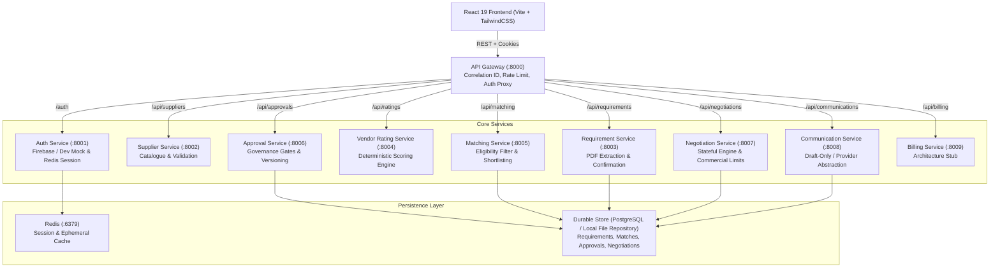
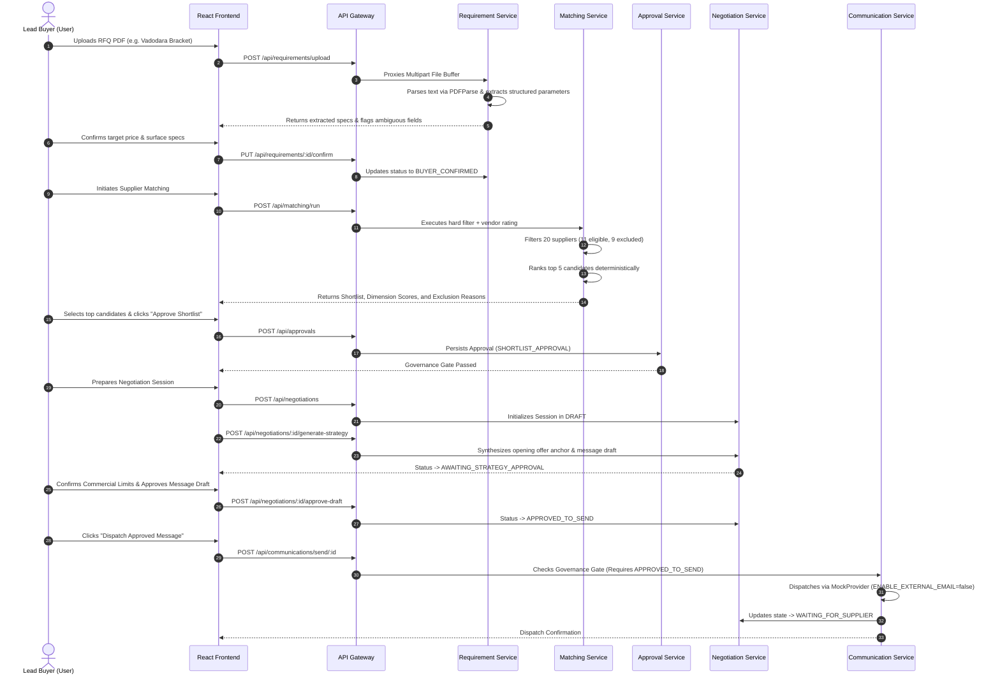

# ProcureAI System Architecture & Microservices Topology

## 1. High-Level System Overview

ProcureAI is an AI-assisted, human-governed procurement and negotiation platform designed for manufacturing enterprises, specifically targeting Indian precision engineering and component manufacturing ecosystems (Vadodara, Pune, Rajkot, Ahmedabad, Peenya, Coimbatore, etc.).

Unlike opaque "autonomous" agents that execute commercial commitments without oversight, ProcureAI is architected around **strict deterministic application boundaries**, **explainable vendor suitability scoring**, and **persisted human approval gates**.

---

## 2. Microservice Boundaries & Responsibilities

| Service | Port | Primary Responsibility | Data Owned |
| :--- | :---: | :--- | :--- |
| **Gateway** | `8000` | Central entry point, request proxying, correlation ID assignment, rate limiting, aggregated health checks. | Transient request logs. |
| **Auth Service** | `8001` | User identity, session persistence, role-based authorization (buyer vs admin), dev-mode auth bypass. | User accounts, active sessions in Redis. |
| **Supplier Service** | `8002` | Validating and serving the 20-supplier synthetic Indian manufacturing catalogue, evidence queries, contact redaction. | `suppliers.json`, `schema.json`. |
| **Requirement Service** | `8003` | PDF parsing, selectable text extraction, scanned PDF detection, structured schema extraction, buyer confirmation. | `requirements` records. |
| **Vendor Rating Service** | `8004` | 100% deterministic calculation of 5-dimension suitability scores, confidence indices, and explainable breakdowns. | Scoring configuration & model versions. |
| **Matching Service** | `8005` | Hard eligibility filtering (processes, materials, MOQ, ISO certs), candidate ranking, top-5 shortlist generation, exclusion explanations. | `matching_runs` records. |
| **Approval Service** | `8006` | Enforcing human governance gates before external communication or commercial commitments. Proposal versioning. | `approvals` records. |
| **Negotiation Service** | `8007` | Stateful negotiation lifecycle, reservation limits, AI strategy formulation, counteroffer analysis. | `negotiations` sessions. |
| **Communication Service** | `8008` | Safe draft-only supplier messaging, provider abstraction (`MockEmailProvider` vs `LiveEmailProvider`). | `negotiation_messages` records. |
| **Billing Service** | `8009` | Preserved directory structure stub for future enterprise tier billing. | Subscription metadata. |

---

## 3. End-to-End Request Flow

---

## 4. Architectural Principles & Safeguards

1. **Deterministic Core:** Numerical scores, process matching, and eligibility checks are computed 100% deterministically. LLMs provide natural language commentary and strategy suggestions but cannot arbitrarily change scores or override compliance filters.
2. **Approval Gating:** The Communication Service strictly blocks message dispatch unless the parent negotiation session has an explicit `APPROVED_TO_SEND` state recorded by an authorized buyer.
3. **Safe Local Development Mode:** Zero paid API keys, zero external database instances, and zero external mail servers are required to run the platform locally or pass tests.
4. **Resilient Persistence:** The durable repository connects to PostgreSQL when `DATABASE_URL` is set, but seamlessly falls back to atomic local JSON storage in `backend/data/store/` when running offline.
