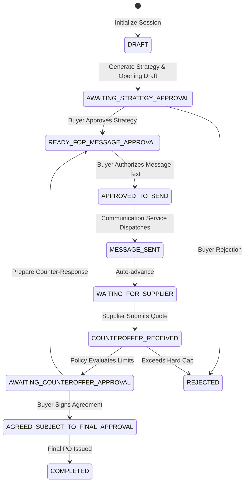

# Negotiation Lifecycle & Governance State Machine

## 1. Negotiation State Machine

The negotiation service (`services/negotiation/`) implements a state machine ensuring that no external message is sent and no commercial agreement is finalized without documented human authorization.

---

## 2. Permitted Transitions Reference

| Current State | Permitted Target States | Triggering Event / Gate |
| :--- | :--- | :--- |
| `DRAFT` | `AWAITING_STRATEGY_APPROVAL`, `CANCELLED` | Strategy synthesized by Negotiation Agent. |
| `AWAITING_STRATEGY_APPROVAL` | `READY_FOR_MESSAGE_APPROVAL`, `REJECTED`, `CANCELLED` | Buyer approves commercial limits. |
| `READY_FOR_MESSAGE_APPROVAL` | `APPROVED_TO_SEND`, `AWAITING_STRATEGY_APPROVAL`, `CANCELLED` | Buyer inspects and approves draft email text. |
| `APPROVED_TO_SEND` | `MESSAGE_SENT`, `READY_FOR_MESSAGE_APPROVAL` | Outbound communication dispatched. |
| `MESSAGE_SENT` | `WAITING_FOR_SUPPLIER` | Message delivery recorded. |
| `WAITING_FOR_SUPPLIER` | `COUNTEROFFER_RECEIVED`, `AGREED_SUBJECT_TO_FINAL_APPROVAL` | Supplier response logged. |
| `COUNTEROFFER_RECEIVED` | `AWAITING_COUNTEROFFER_APPROVAL`, `REJECTED` | Counteroffer policy evaluated. |
| `AWAITING_COUNTEROFFER_APPROVAL`| `READY_FOR_MESSAGE_APPROVAL`, `AGREED_SUBJECT_TO_FINAL_APPROVAL` | Buyer counter-offers or settles. |
| `AGREED_SUBJECT_TO_FINAL_APPROVAL`| `COMPLETED`, `CANCELLED` | Final purchase order signoff. |

---

## 3. Commercial Reservation Limits & Policy Evaluation

When a supplier submits a counteroffer, `evaluateSupplierCounteroffer` tests the quote against the session's pre-authorized commercial limits:

1. **Case 1: Counteroffer $\le$ Buyer Target (e.g. Quoted ₹475 vs Target ₹480)**
   - *Verdict:* `HIGHLY_FAVORABLE`
   - *Action:* `RECOMMEND_ACCEPTANCE`
   - *Rationale:* Price meets or beats baseline target. Recommended for agreement subject to final signoff.
2. **Case 2: Buyer Target $<$ Counteroffer $\le$ Authorized Reservation Cap (e.g. Quoted ₹492 vs Cap ₹500)**
   - *Verdict:* `ACCEPTABLE_WITH_CONCESSION`
   - *Action:* `COUNTER_SPLIT_DIFFERENCE`
   - *Rationale:* Supplier price is within allowable tolerance (+2.5%). Recommends counter-offering at ₹486 by leveraging volume commitments.
3. **Case 3: Counteroffer $>$ Authorized Reservation Cap (e.g. Quoted ₹540 vs Cap ₹500)**
   - *Verdict:* `EXCEEDS_AUTHORIZED_LIMIT`
   - *Action:* `ESCALATE_TO_LEAD_BUYER`
   - *Rationale:* Strict violation of commercial reservation limit. Autonomous acceptance blocked; requires lead buyer escalation.

---

## 4. Audit History & Concurrency Controls

- Every status transition is timestamped and appended to `session.statusHistory` with the actor's verified email.
- Duplicate session creation against the same supplier and requirement is blocked with idempotent retrieval.
- Communication dispatch is guarded by an atomic state check: if a message send request arrives when the session is not in `APPROVED_TO_SEND`, the request is rejected with `403 Forbidden`.
