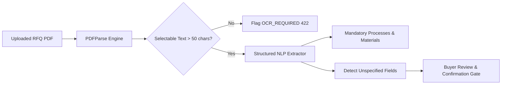

# Requirement Processing & Document Ingestion

## 1. Supported Document Formats
The initial MVP supports **text-based PDF documents** up to **10MB** in file size.

### Document Parser Design
The parser module (`services/requirement/documentParser.js`) is decoupled from extraction logic:
- Validates mime type (`application/pdf`) and file size limits.
- Extracts raw selectable text and page count using `pdf-parse`.
- **Scanned / Image-Only PDF Detection:** If the document contains pages but fewer than 50 selectable characters or fewer than 10 words, the parser identifies it as a scanned/rasterized document and returns:
  ```json
  {
    "code": "OCR_REQUIRED",
    "message": "The uploaded PDF appears to be a scanned or image-only document. Text could not be extracted without OCR capability."
  }
  ```

---

## 2. Structured Extraction Pipeline

The extraction engine (`services/requirement/requirementExtractor.js`) scans the extracted text using deterministic pattern matchers and domain heuristics:



### Extracted Parameter Schema
1. **Title:** Component name (e.g. *Precision CNC Machined Aluminium Mounting Bracket*).
2. **Target Quantity:** Production lot volume (e.g. *5,000 pieces*).
3. **Requested Lead Time:** Calendar days to first delivery (e.g. *30 days*).
4. **Target Unit Price:** Budget threshold (e.g. *₹480.00*).
5. **Materials:** Alloy grades (e.g. *Aluminium 6061-T6*).
6. **Mandatory Processes:** Technical operations (e.g. *4-Axis CNC Milling*, *CNC Turning*).
7. **Compliance Criteria:** Quality certifications (e.g. *ISO 9001:2015*, *IATF 16949*).
8. **Quality Standards:** CMM inspection requirement, laser QR traceability, approved drawing reference.

---

## 3. Mandatory Constraints vs Preferences

| Category | Field | Matching Behavior |
| :--- | :--- | :--- |
| **Hard Constraint** | `mandatoryProcesses` | Non-negotiable. Suppliers lacking exact process are immediately disqualified. |
| **Hard Constraint** | `materials` | Non-negotiable. Suppliers unable to machine specified alloy are disqualified. |
| **Hard Constraint** | `minimumOrderQuantity` | Disqualifies suppliers whose MOQ is > 1.5x requirement lot size. |
| **Hard Constraint** | `requiredCertifications` | Suppliers lacking valid certificate are excluded. |
| **Preference / Scored** | `leadTimeDays` | Scored continuously (100 pts if <= target; penalty if exceeded). |
| **Preference / Scored** | `indicativeUnitPrice` | Evaluated against target budget (concession calculation). |
| **Preference / Scored** | `cmmInspectionRequired` | Bonus score (+30 pts in Quality dimension). |
| **Preference / Scored** | `traceabilityRequired` | Bonus score (+25 pts in Quality dimension). |

---

## 4. Unspecified Fields & Buyer Confirmation

ProcureAI adheres to a strict principle: **never silently invent technical specifications**.

When the parser processes a document where key operational parameters are omitted (such as the sample Vadodara RFQ where surface treatment, machining tolerances, or target price are left unspecified), it populates `unspecifiedFields`:
```json
{
  "field": "surfaceTreatment",
  "description": "Surface finish / anodizing grade and color are unspecified in RFQ text",
  "suggestedValue": "Hard Anodizing (Type III) Black",
  "importance": "medium"
}
```
The requirement is placed in state `PARSED_PENDING_CONFIRMATION`. The buyer can inspect and confirm or override these parameters via `PUT /api/requirements/:id/confirm`, which advances status to `BUYER_CONFIRMED`.
